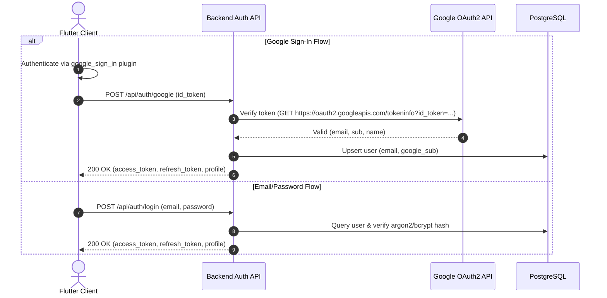

# 🌸 Bloom — Backend & Cloud Architecture Technical Specification

**Document Version:** 1.0.0-PROD  
**Target Audience:** Backend Engineering Team, Database Administrators, Mobile Tech Lead  
**Scope:** PostgreSQL Schema, REST API Contracts, Offline-First Sync Engine, Google ID Token Auth, and Google Play Data Safety Compliance

---

## 1. Executive Summary & Architecture Overview

Bloom is an offline-first menstrual cycle tracking and hormonal health companion built with Flutter, Riverpod, and Drift (SQLite). The client application operates 100% offline using client-generated IDs and local Drift repositories.

To support cloud backup, multi-device synchronization, and user account management, the backend must provide:
1. **A Normalized PostgreSQL Database** mirroring Bloom's local SQLite tables with strict constraints, cascading foreign keys, and performant indexes.
2. **Stateless JWT Authentication** supporting Email/Password, Google Sign-In via Google ID Token verification, and guest account migration.
3. **An Offline-First Delta Sync Engine** implementing Last-Write-Wins (LWW) conflict resolution using timestamp vectors and soft-delete tombstones.
4. **Google Play Compliance Endpoints** for irrevocable account deletion, data wipe, and machine-readable data export (GDPR / Google Play Data Safety).
5. **Specialized App Services** supporting remote AI Doctor Report generation and customer support issue submission.

```
┌────────────────────────────────────────────────────────┐
│                   Bloom Flutter App                    │
│   (Drift SQLite + Riverpod + Secure Storage + Dio)     │
└──────────▲─────────────────▲──────────────────▲────────┘
           │                 │                  │
   Bearer JWT Tokens   POST /sync/push   GET /sync/pull?since=...
           │                 │                  │
┌──────────▼─────────────────▼──────────────────▼────────┐
│               Bloom Backend REST API                   │
│          (Go / Node.js / Python / Rust / Java)         │
├────────────────────────────────────────────────────────┤
│  • Google ID Token Verifier (Google OAuth2 API)        │
│  • Auth & Session Manager (JWT Access + Refresh)       │
│  • Bidirectional Sync Engine (LWW Conflict Resolver)   │
│  • Account Management & Export/Delete Worker           │
│  • Clinical AI Summary Proxy                           │
└──────────────────────────┬─────────────────────────────┘
                           │
             PostgreSQL 15+ (Hosted Server)
```

---

## 2. Data Models & Database Schemas (PostgreSQL)

### 2.1 Critical Primary Key Audit: Client Strings vs. Postgres UUIDs
- **Current Client SQLite State:** The Flutter app defines all primary keys as `TextColumn get id => text()();`.
- **Finding:** While modern repositories (`ReminderRepository`, `DailyCheckinNotifier`, `DatabaseSeeder`) generate standard **UUID v4** strings via the Dart `uuid` package, legacy paths in `GoalsPage` and `PeriodLogPage` previously generated string IDs from timestamps (e.g., `1729188000000` or `1729188000000_log`).
- **Backend Specification Rule:** In PostgreSQL, all primary keys and foreign keys MUST use the native `UUID` type. 
  * The Flutter client will standardize all entities to `Uuid().v4()` before transmission.
  * For legacy migration or temporary compatibility during rollout, the backend can either accept UUID strings or apply `uuid_generate_v4()` fallback if a non-UUID string is encountered.

### 2.2 Sync Metadata Columns Audit
To enable bidirectional delta synchronization, every table must include these three sync metadata columns:
1. `updated_at TIMESTAMPTZ NOT NULL DEFAULT NOW()`: High-precision timestamp used by the sync engine to compute deltas (`updated_at > since`) and resolve conflicts (Last-Write-Wins).
2. `is_deleted BOOLEAN NOT NULL DEFAULT FALSE`: Soft delete tombstone. Physical deletion must not occur on the client or server during normal sync operations, otherwise other devices cannot know a record was removed.
3. `created_at TIMESTAMPTZ NOT NULL DEFAULT NOW()`: Audit timestamp.

> [!IMPORTANT]
> **Codebase Discrepancy Identified:**
> In the local Drift SQLite schema, `DailySymptoms` and `AiInsights` currently have `createdAt`, but **lack `updatedAt`**. For production sync, `updated_at` MUST be present in all server tables (and added to local Drift schemas in Migration v3).

---

### 2.3 PostgreSQL Production DDL (`schema.sql`)

```sql
-- Enable cryptographic extensions for UUID generation
CREATE EXTENSION IF NOT EXISTS "uuid-ossp";
CREATE EXTENSION IF NOT EXISTS "pgcrypto";

-- ==============================================================================
-- 1. USERS & CREDENTIALS TABLE (Auth Identity)
-- ==============================================================================
CREATE TABLE IF NOT EXISTS users (
    id UUID PRIMARY KEY DEFAULT uuid_generate_v4(),
    email TEXT UNIQUE,
    password_hash TEXT, -- NULL for Google-only sign-in
    google_sub TEXT UNIQUE, -- Google Subject identifier
    is_anonymous BOOLEAN NOT NULL DEFAULT FALSE,
    is_active BOOLEAN NOT NULL DEFAULT TRUE,
    created_at TIMESTAMPTZ NOT NULL DEFAULT NOW(),
    updated_at TIMESTAMPTZ NOT NULL DEFAULT NOW(),
    last_login_at TIMESTAMPTZ
);

-- ==============================================================================
-- 2. USER PROFILES TABLE (Health Profile & Cycle Baseline)
-- ==============================================================================
CREATE TABLE IF NOT EXISTS user_profiles (
    id UUID PRIMARY KEY REFERENCES users(id) ON DELETE CASCADE,
    name TEXT NOT NULL DEFAULT 'User',
    email TEXT,
    phone TEXT,
    avatar_path TEXT,
    date_of_birth DATE,
    height_cm NUMERIC(5,2),
    weight_kg NUMERIC(5,2),
    blood_group TEXT CHECK (blood_group IN ('A+', 'A-', 'B+', 'B-', 'AB+', 'AB-', 'O+', 'O-', 'Don''t know')),
    avg_cycle_length INTEGER NOT NULL DEFAULT 28 CHECK (avg_cycle_length BETWEEN 15 AND 60),
    avg_period_length INTEGER NOT NULL DEFAULT 5 CHECK (avg_period_length BETWEEN 1 AND 15),
    primary_goal TEXT, -- Comma-separated or tag list: 'track_period, understand_symptoms'
    
    -- Feature toggles matching Drift UserProfiles schema v2
    period_prediction_enabled BOOLEAN NOT NULL DEFAULT TRUE,
    ovulation_prediction_enabled BOOLEAN NOT NULL DEFAULT TRUE,
    fertile_window_enabled BOOLEAN NOT NULL DEFAULT TRUE,

    -- Cloud sync metadata
    created_at TIMESTAMPTZ NOT NULL DEFAULT NOW(),
    updated_at TIMESTAMPTZ NOT NULL DEFAULT NOW(),
    is_deleted BOOLEAN NOT NULL DEFAULT FALSE
);

-- ==============================================================================
-- 3. USER PRIVACY & APP SETTINGS TABLE
-- ==============================================================================
CREATE TABLE IF NOT EXISTS user_settings (
    user_id UUID PRIMARY KEY REFERENCES users(id) ON DELETE CASCADE,
    is_discrete_notifications_enabled BOOLEAN NOT NULL DEFAULT TRUE,
    is_ai_data_usage_enabled BOOLEAN NOT NULL DEFAULT TRUE,
    is_analytics_enabled BOOLEAN NOT NULL DEFAULT TRUE,
    is_personalized_recommendations_enabled BOOLEAN NOT NULL DEFAULT TRUE,
    auto_lock_time TEXT NOT NULL DEFAULT '5 minutes',
    created_at TIMESTAMPTZ NOT NULL DEFAULT NOW(),
    updated_at TIMESTAMPTZ NOT NULL DEFAULT NOW()
);

-- ==============================================================================
-- 4. CYCLES TABLE (Menstrual Cycles)
-- ==============================================================================
CREATE TABLE IF NOT EXISTS cycles (
    id UUID PRIMARY KEY DEFAULT uuid_generate_v4(),
    user_id UUID NOT NULL REFERENCES users(id) ON DELETE CASCADE,
    start_date DATE NOT NULL,
    end_date DATE,
    cycle_length INTEGER CHECK (cycle_length IS NULL OR (cycle_length >= 10 AND cycle_length <= 100)),
    period_length INTEGER CHECK (period_length IS NULL OR (period_length >= 1 AND period_length <= 30)),
    is_predicted BOOLEAN NOT NULL DEFAULT FALSE,
    created_at TIMESTAMPTZ NOT NULL DEFAULT NOW(),
    updated_at TIMESTAMPTZ NOT NULL DEFAULT NOW(),
    is_deleted BOOLEAN NOT NULL DEFAULT FALSE,
    CONSTRAINT check_cycle_dates CHECK (end_date IS NULL OR end_date >= start_date)
);

-- ==============================================================================
-- 5. DAILY LOGS TABLE (Primary Calendar Health Journal)
-- ==============================================================================
CREATE TABLE IF NOT EXISTS daily_logs (
    id UUID PRIMARY KEY DEFAULT uuid_generate_v4(),
    user_id UUID NOT NULL REFERENCES users(id) ON DELETE CASCADE,
    cycle_id UUID REFERENCES cycles(id) ON DELETE SET NULL,
    date DATE NOT NULL,
    flow_intensity TEXT CHECK (flow_intensity IN ('spotting', 'light', 'medium', 'heavy', 'very_heavy')),
    pain_level INTEGER CHECK (pain_level IS NULL OR (pain_level >= 0 AND pain_level <= 10)),
    mood TEXT CHECK (mood IN ('great', 'good', 'okay', 'not_great', 'bad', 'Great', 'Good', 'Okay', 'Not great', 'Bad')),
    sleep_hours NUMERIC(4,2) CHECK (sleep_hours IS NULL OR (sleep_hours >= 0 AND sleep_hours <= 24)),
    water_intake TEXT, -- e.g., '1.5 L', '2.0 L'
    stress_level INTEGER CHECK (stress_level IS NULL OR (stress_level >= 0 AND stress_level <= 10)),
    activity_level TEXT CHECK (activity_level IN ('sedentary', 'moderate', 'active', 'Sedentary', 'Moderate', 'Active')),
    remedies TEXT, -- Comma-separated remedies: 'Heating pad, Herbal tea'
    pain_after_1hr INTEGER CHECK (pain_after_1hr IS NULL OR (pain_after_1hr >= 0 AND pain_after_1hr <= 10)),
    notes TEXT,
    created_at TIMESTAMPTZ NOT NULL DEFAULT NOW(),
    updated_at TIMESTAMPTZ NOT NULL DEFAULT NOW(),
    is_deleted BOOLEAN NOT NULL DEFAULT FALSE,
    UNIQUE(user_id, date)
);

-- ==============================================================================
-- 6. DAILY SYMPTOMS TABLE (Multi-select Normalized Physical Symptoms)
-- ==============================================================================
CREATE TABLE IF NOT EXISTS daily_symptoms (
    id UUID PRIMARY KEY DEFAULT uuid_generate_v4(),
    daily_log_id UUID NOT NULL REFERENCES daily_logs(id) ON DELETE CASCADE,
    symptom_name TEXT NOT NULL,
    severity INTEGER CHECK (severity IS NULL OR (severity >= 0 AND severity <= 10)),
    created_at TIMESTAMPTZ NOT NULL DEFAULT NOW(),
    updated_at TIMESTAMPTZ NOT NULL DEFAULT NOW(),
    is_deleted BOOLEAN NOT NULL DEFAULT FALSE
);

-- ==============================================================================
-- 7. REMINDERS TABLE (User Push / Notification Preferences)
-- ==============================================================================
CREATE TABLE IF NOT EXISTS reminders (
    id UUID PRIMARY KEY DEFAULT uuid_generate_v4(),
    user_id UUID NOT NULL REFERENCES users(id) ON DELETE CASCADE,
    type TEXT NOT NULL CHECK (type IN ('period_start', 'ovulation', 'fertile_window', 'daily_log', 'cycle_summary', 'quiet_hours', 'medication')),
    time_of_day TEXT NOT NULL, -- Format: 'HH:mm' or 'HH:mm - HH:mm'
    days_before INTEGER NOT NULL DEFAULT 1 CHECK (days_before >= 0),
    is_enabled BOOLEAN NOT NULL DEFAULT TRUE,
    created_at TIMESTAMPTZ NOT NULL DEFAULT NOW(),
    updated_at TIMESTAMPTZ NOT NULL DEFAULT NOW(),
    is_deleted BOOLEAN NOT NULL DEFAULT FALSE
);

-- ==============================================================================
-- 8. AI INSIGHTS CACHE TABLE (Generated Analysis & Doctor Summary)
-- ==============================================================================
CREATE TABLE IF NOT EXISTS ai_insights (
    id UUID PRIMARY KEY DEFAULT uuid_generate_v4(),
    user_id UUID NOT NULL REFERENCES users(id) ON DELETE CASCADE,
    category TEXT NOT NULL CHECK (category IN ('home_summary', 'compare_cycles', 'pain_insights', 'mood_trends', 'lifestyle', 'doctor_report')),
    cycle_phase TEXT CHECK (cycle_phase IS NULL OR cycle_phase IN ('menstrual', 'follicular', 'ovulatory', 'luteal')),
    headline TEXT,
    insight_text TEXT NOT NULL,
    generated_date DATE NOT NULL,
    created_at TIMESTAMPTZ NOT NULL DEFAULT NOW(),
    updated_at TIMESTAMPTZ NOT NULL DEFAULT NOW(),
    is_deleted BOOLEAN NOT NULL DEFAULT FALSE
);

-- ==============================================================================
-- 9. AUTH REFRESH TOKENS TABLE (Device Session Persistence)
-- ==============================================================================
CREATE TABLE IF NOT EXISTS auth_refresh_tokens (
    id UUID PRIMARY KEY DEFAULT uuid_generate_v4(),
    user_id UUID NOT NULL REFERENCES users(id) ON DELETE CASCADE,
    token_hash TEXT NOT NULL UNIQUE,
    device_info TEXT,
    expires_at TIMESTAMPTZ NOT NULL,
    created_at TIMESTAMPTZ NOT NULL DEFAULT NOW(),
    revoked_at TIMESTAMPTZ
);

-- ==============================================================================
-- 10. SUPPORT & BUG REPORTS TABLE (Feedback & In-App Reports)
-- ==============================================================================
CREATE TABLE IF NOT EXISTS support_tickets (
    id UUID PRIMARY KEY DEFAULT uuid_generate_v4(),
    user_id UUID REFERENCES users(id) ON DELETE SET NULL,
    email TEXT,
    ticket_type TEXT NOT NULL CHECK (ticket_type IN ('problem_report', 'feature_suggestion', 'feedback', 'contact_support')),
    title TEXT,
    description TEXT NOT NULL,
    app_version TEXT,
    device_model TEXT,
    os_version TEXT,
    attachment_urls TEXT[],
    created_at TIMESTAMPTZ NOT NULL DEFAULT NOW()
);

-- ==============================================================================
-- INDEXES FOR SYNC & QUERY PERFORMANCE
-- ==============================================================================
CREATE INDEX IF NOT EXISTS idx_cycles_user_updated ON cycles(user_id, updated_at);
CREATE INDEX IF NOT EXISTS idx_cycles_user_dates ON cycles(user_id, start_date DESC);
CREATE INDEX IF NOT EXISTS idx_daily_logs_user_updated ON daily_logs(user_id, updated_at);
CREATE INDEX IF NOT EXISTS idx_daily_logs_user_date ON daily_logs(user_id, date);
CREATE INDEX IF NOT EXISTS idx_daily_symptoms_log_updated ON daily_symptoms(daily_log_id, updated_at);
CREATE INDEX IF NOT EXISTS idx_reminders_user_updated ON reminders(user_id, updated_at);
CREATE INDEX IF NOT EXISTS idx_ai_insights_user_updated ON ai_insights(user_id, updated_at);
CREATE INDEX IF NOT EXISTS idx_refresh_tokens_user ON auth_refresh_tokens(user_id);
```

---

## 3. Authentication & User Profile Requirements

### 3.1 Authentication Architecture
The backend will issue standard stateless **JWT (JSON Web Tokens)**:
- **Access Token:** Short-lived (e.g., 15 minutes to 1 hour). Passed via `Authorization: Bearer <token>`.
- **Refresh Token:** Long-lived (e.g., 30 to 90 days), securely hashed (`SHA-256`) and stored in `auth_refresh_tokens`. Supports rotation.



### 3.2 Guest / Anonymous Migration Flow
1. When a new user downloads Bloom, local SQLite runs immediately without an account (`name: 'Guest'`, generated local UUID).
2. When the user completes onboarding or registers from `/signup`:
   - The client calls `POST /api/auth/register` (or `POST /api/auth/google`).
   - The client immediately executes an initial `POST /api/sync/push`, where all local records (created while guest) are linked to the authenticated user's ID.
   - The backend adopts the client-generated UUIDs into the user's permanent dataset.

### 3.3 Password Reset Flow
- `POST /api/auth/forgot-password`: Receives `{ "email": "user@example.com" }`. Generates a cryptographically secure random token (expiry 15 mins) and emails a password reset link or 6-digit OTP.
- `POST /api/auth/reset-password`: Receives `{ "token": "...", "new_password": "..." }`. Validates token, hashes password using Argon2id or Bcrypt (cost >= 12), invalidates active sessions, and updates password.

---

## 4. Offline-First Bidirectional Sync Engine Protocol

### 4.1 Sync Mechanism: Timestamp-Based Delta Sync
- **Local Client State Tracking:**
  * Every Drift table in Bloom contains `is_synced (bool)`. When local rows are inserted or updated, `is_synced` is set to `false`, and `updated_at` is set to `DateTime.now()`.
  * Soft delete sets `is_deleted = true`, `is_synced = false`, `updated_at = DateTime.now()`.
- **Sync Trigger Points:**
  1. App launch (after splash screen).
  2. Manual button tap in `AppSettingsPage` ("Sync now").
  3. Reconnection event detected by network connectivity listener.
  4. App backgrounding / periodic timer.

### 4.2 Push Protocol: `POST /api/sync/push`
Sends dirty (unsynced) records created or modified locally.

#### Request Headers
```http
POST /api/sync/push HTTP/1.1
Host: api.bloomapp.com
Authorization: Bearer <ACCESS_TOKEN>
Content-Type: application/json
```

#### Request Body
```json
{
  "client_sync_time": "2026-10-17T17:30:00.000Z",
  "data": {
    "user_profile": {
      "id": "e4b9a112-70b6-4b8c-b695-1f6f17dc9821",
      "name": "Zoya",
      "email": "zoya@example.com",
      "phone": "+1234567890",
      "avatar_path": "assets/images/Setting_avatar.png",
      "date_of_birth": "2002-01-12",
      "height_cm": 165.0,
      "weight_kg": 60.0,
      "blood_group": "O+",
      "avg_cycle_length": 29,
      "avg_period_length": 5,
      "primary_goal": "track_period, understand_symptoms",
      "period_prediction_enabled": true,
      "ovulation_prediction_enabled": true,
      "fertile_window_enabled": true,
      "updated_at": "2026-10-17T17:28:00.000Z",
      "is_deleted": false
    },
    "user_settings": {
      "is_discrete_notifications_enabled": true,
      "is_ai_data_usage_enabled": true,
      "is_analytics_enabled": true,
      "is_personalized_recommendations_enabled": true,
      "auto_lock_time": "5 minutes",
      "updated_at": "2026-10-17T17:28:00.000Z"
    },
    "cycles": [
      {
        "id": "5f3a0279-d128-4f81-a916-dcf04400c411",
        "start_date": "2026-10-01",
        "end_date": "2026-10-29",
        "cycle_length": 28,
        "period_length": 5,
        "is_predicted": false,
        "created_at": "2026-10-01T08:00:00.000Z",
        "updated_at": "2026-10-17T17:20:00.000Z",
        "is_deleted": false
      }
    ],
    "daily_logs": [
      {
        "id": "7a94f610-8647-4e78-958b-967a91176b5c",
        "cycle_id": "5f3a0279-d128-4f81-a916-dcf04400c411",
        "date": "2026-10-17",
        "flow_intensity": "medium",
        "pain_level": 4,
        "mood": "good",
        "sleep_hours": 7.5,
        "water_intake": "2.0 L",
        "stress_level": 3,
        "activity_level": "moderate",
        "remedies": "Warm compress, chamomile tea",
        "pain_after_1hr": 2,
        "notes": "Felt much better in the afternoon",
        "created_at": "2026-10-17T09:00:00.000Z",
        "updated_at": "2026-10-17T17:25:00.000Z",
        "is_deleted": false
      }
    ],
    "daily_symptoms": [
      {
        "id": "1d8cf4b3-030a-472a-b6d8-e4b097b830cb",
        "daily_log_id": "7a94f610-8647-4e78-958b-967a91176b5c",
        "symptom_name": "Cramps",
        "severity": 4,
        "created_at": "2026-10-17T09:00:00.000Z",
        "updated_at": "2026-10-17T17:25:00.000Z",
        "is_deleted": false
      }
    ],
    "reminders": [
      {
        "id": "9c0fe3d8-5541-4560-8452-94ea6b25ea03",
        "type": "period_start",
        "time_of_day": "09:00",
        "days_before": 2,
        "is_enabled": true,
        "created_at": "2026-10-01T08:00:00.000Z",
        "updated_at": "2026-10-17T17:20:00.000Z",
        "is_deleted": false
      }
    ],
    "ai_insights": [
      {
        "id": "3a0889bf-1e64-44df-973a-44161bb7d174",
        "category": "home_summary",
        "cycle_phase": "luteal",
        "headline": "Restorative Phase",
        "insight_text": "Progesterone is steady. Gentle routines will keep energy balanced.",
        "generated_date": "2026-10-17",
        "created_at": "2026-10-17T08:00:00.000Z",
        "updated_at": "2026-10-17T17:20:00.000Z",
        "is_deleted": false
      }
    ]
  }
}
```

#### Server Conflict Resolution Logic (Last-Write-Wins)
When receiving an incoming record:
```sql
INSERT INTO daily_logs (id, user_id, cycle_id, date, flow_intensity, pain_level, mood, sleep_hours, water_intake, stress_level, activity_level, remedies, pain_after_1hr, notes, created_at, updated_at, is_deleted)
VALUES ($1, $user_id, $2, $3, $4, $5, $6, $7, $8, $9, $10, $11, $12, $13, $14, $15, $16)
ON CONFLICT (id) DO UPDATE SET
    cycle_id = EXCLUDED.cycle_id,
    date = EXCLUDED.date,
    flow_intensity = EXCLUDED.flow_intensity,
    pain_level = EXCLUDED.pain_level,
    mood = EXCLUDED.mood,
    sleep_hours = EXCLUDED.sleep_hours,
    water_intake = EXCLUDED.water_intake,
    stress_level = EXCLUDED.stress_level,
    activity_level = EXCLUDED.activity_level,
    remedies = EXCLUDED.remedies,
    pain_after_1hr = EXCLUDED.pain_after_1hr,
    notes = EXCLUDED.notes,
    updated_at = EXCLUDED.updated_at,
    is_deleted = EXCLUDED.is_deleted
WHERE EXCLUDED.updated_at >= daily_logs.updated_at;
```

#### Push Response: `200 OK`
```json
{
  "status": "success",
  "server_sync_time": "2026-10-17T17:30:05.123Z",
  "processed": {
    "user_profile": true,
    "user_settings": true,
    "cycles": ["5f3a0279-d128-4f81-a916-dcf04400c411"],
    "daily_logs": ["7a94f610-8647-4e78-958b-967a91176b5c"],
    "daily_symptoms": ["1d8cf4b3-030a-472a-b6d8-e4b097b830cb"],
    "reminders": ["9c0fe3d8-5541-4560-8452-94ea6b25ea03"],
    "ai_insights": ["3a0889bf-1e64-44df-973a-44161bb7d174"]
  }
}
```
*Client Action:* The client loops through confirmed IDs and marks `is_synced = true` where `updated_at <= server_sync_time`.

---

### 4.3 Pull Protocol: `GET /api/sync/pull?since={timestamp}`
Used to fetch changes made on other devices or to perform a full restore after reinstalling.

#### Request
```http
GET /api/sync/pull?since=2026-10-01T00:00:00.000Z HTTP/1.1
Host: api.bloomapp.com
Authorization: Bearer <ACCESS_TOKEN>
```
*(If `since` parameter is omitted, returns all non-deleted historical records for full re-hydration).*

#### Response: `200 OK`
```json
{
  "status": "success",
  "server_sync_time": "2026-10-17T17:35:10.000Z",
  "changes": {
    "user_profile": {
      "id": "e4b9a112-70b6-4b8c-b695-1f6f17dc9821",
      "name": "Zoya",
      "email": "zoya@example.com",
      "phone": "+1234567890",
      "avatar_path": "assets/images/Setting_avatar.png",
      "date_of_birth": "2002-01-12",
      "height_cm": 165.0,
      "weight_kg": 60.0,
      "blood_group": "O+",
      "avg_cycle_length": 29,
      "avg_period_length": 5,
      "primary_goal": "track_period, understand_symptoms",
      "period_prediction_enabled": true,
      "ovulation_prediction_enabled": true,
      "fertile_window_enabled": true,
      "updated_at": "2026-10-17T17:28:00.000Z",
      "is_deleted": false
    },
    "user_settings": {
      "is_discrete_notifications_enabled": true,
      "is_ai_data_usage_enabled": true,
      "is_analytics_enabled": true,
      "is_personalized_recommendations_enabled": true,
      "auto_lock_time": "5 minutes",
      "updated_at": "2026-10-17T17:28:00.000Z"
    },
    "cycles": [
      {
        "id": "5f3a0279-d128-4f81-a916-dcf04400c411",
        "start_date": "2026-10-01",
        "end_date": "2026-10-29",
        "cycle_length": 28,
        "period_length": 5,
        "is_predicted": false,
        "created_at": "2026-10-01T08:00:00.000Z",
        "updated_at": "2026-10-17T17:20:00.000Z",
        "is_deleted": false
      }
    ],
    "daily_logs": [
      {
        "id": "7a94f610-8647-4e78-958b-967a91176b5c",
        "cycle_id": "5f3a0279-d128-4f81-a916-dcf04400c411",
        "date": "2026-10-17",
        "flow_intensity": "medium",
        "pain_level": 4,
        "mood": "good",
        "sleep_hours": 7.5,
        "water_intake": "2.0 L",
        "stress_level": 3,
        "activity_level": "moderate",
        "remedies": "Warm compress, chamomile tea",
        "pain_after_1hr": 2,
        "notes": "Felt much better in the afternoon",
        "created_at": "2026-10-17T09:00:00.000Z",
        "updated_at": "2026-10-17T17:25:00.000Z",
        "is_deleted": false
      }
    ],
    "daily_symptoms": [
      {
        "id": "1d8cf4b3-030a-472a-b6d8-e4b097b830cb",
        "daily_log_id": "7a94f610-8647-4e78-958b-967a91176b5c",
        "symptom_name": "Cramps",
        "severity": 4,
        "created_at": "2026-10-17T09:00:00.000Z",
        "updated_at": "2026-10-17T17:25:00.000Z",
        "is_deleted": false
      }
    ],
    "reminders": [],
    "ai_insights": []
  }
}
```

*Client Action:* The Flutter app wraps incoming changes into an SQLite transaction using `insertOnConflictUpdate`. If `is_deleted == true`, the local row is soft-deleted.

---

### 4.4 Health Data Privacy & Encryption Architecture

Menstrual health records are sensitive Personal Health Information (PHI). We specify two viable privacy architectural models:

| Privacy Model | How it Works | Pros | Trade-offs | Recommendation |
| :--- | :--- | :--- | :--- | :--- |
| **Model A: Server-Side Field Encryption (Recommended)** | PostgreSQL `pgcrypto` or application layer AES-256-GCM encrypts sensitive text fields (`notes`, `remedies`, `pain_level`) at rest. Database connections use TLS 1.3. | Enables server-side Doctor Report generation (`/api/ai/doctor-summary`), automated backup validation, and relational analytics. | Backend holds encryption keys via KMS/Vault. | **Primary Recommended for Production v1.** |
| **Model B: Zero-Knowledge Client-Side E2EE** | Client derives AES-GCM key from user passphrase. Health tables stored as encrypted payload blobs (`ciphertext`, `iv`, `tag`). | Zero-knowledge privacy; server cannot read logs even if subpoenaed or breached. | Cannot run server-side SQL queries, charts, or cloud AI on health logs without client sending decrypted payload. | Optional upgrade for specialized "Zero-Knowledge Mode". |

---

## 5. Account Management & Google Play Compliance

Google Play Data Safety policies strictly require that any app offering user accounts must provide:
1. An in-app account deletion flow.
2. Complete purging of all personal and health records from servers upon deletion.
3. An exportable copy of user data.

### 5.1 Full Account Deletion: `DELETE /api/user/account`
Irrevocably deletes the authenticated user, invalidating all sessions and cascading hard deletes across all health tables.

#### Request
```http
DELETE /api/user/account HTTP/1.1
Host: api.bloomapp.com
Authorization: Bearer <ACCESS_TOKEN>
Content-Type: application/json

{
  "confirmation": "DELETE",
  "password": "currentPassword123" // Required if account has password
}
```

#### Server Deletion Protocol
```sql
BEGIN;
-- Cascades automatically delete:
-- user_profiles, user_settings, cycles, daily_logs, daily_symptoms, reminders, ai_insights, auth_refresh_tokens
DELETE FROM users WHERE id = $user_id;

-- Purge any orphaned support logs or anonymize them:
UPDATE support_tickets SET user_id = NULL, email = 'anonymized@bloom.internal' WHERE user_id = $user_id;
COMMIT;
```

#### Response: `200 OK`
```json
{
  "status": "success",
  "message": "User account and all associated health records have been permanently expunged."
}
```

---

### 5.2 Reset / Wipe Health Tracking Data: `POST /api/user/wipe-tracking-data`
Supports the Bloom UI button *"Delete tracking data"* in `PrivacySecurityPage` (erases logs while preserving user profile & subscription status).

#### Request
```http
POST /api/user/wipe-tracking-data HTTP/1.1
Host: api.bloomapp.com
Authorization: Bearer <ACCESS_TOKEN>
```

#### Server Action
```sql
DELETE FROM cycles WHERE user_id = $user_id;
DELETE FROM daily_logs WHERE user_id = $user_id;
DELETE FROM ai_insights WHERE user_id = $user_id;
```

#### Response: `200 OK`
```json
{
  "status": "success",
  "message": "All cycle history, symptoms, and health logs have been wiped."
}
```

---

### 5.3 Export Data Archive: `GET /api/user/export`
Fulfills GDPR / CCPA *"Right to Access / Data Portability"* and powers the *"Export my data"* UI button in Bloom.

#### Request
```http
GET /api/user/export HTTP/1.1
Host: api.bloomapp.com
Authorization: Bearer <ACCESS_TOKEN>
```

#### Response: `200 OK` (`Content-Type: application/json` or `.zip`)
```json
{
  "export_date": "2026-10-17T17:40:00Z",
  "user_profile": {
    "name": "Zoya",
    "email": "zoya@example.com",
    "avg_cycle_length": 29,
    "avg_period_length": 5
  },
  "cycles": [ ... ],
  "daily_logs": [ ... ],
  "symptoms": [ ... ],
  "reminders": [ ... ]
}
```

---

## 6. Complete API Contracts (REST / OpenAPI 3.0 Summary)

All endpoints accept and return `application/json` unless otherwise specified. Authenticated routes require standard header:
`Authorization: Bearer <JWT_ACCESS_TOKEN>`

| HTTP Method | Route | Description | Auth Required | Request Body Summary | Response Status & Body |
| :--- | :--- | :--- | :---: | :--- | :--- |
| **POST** | `/api/auth/register` | Register new user with email & password | No | `{ email, password, name? }` | `201 Created` → `{ user, access_token, refresh_token }` |
| **POST** | `/api/auth/login` | Log in with email & password | No | `{ email, password }` | `200 OK` → `{ user, access_token, refresh_token }` |
| **POST** | `/api/auth/google` | Verify Google ID token & sign in | No | `{ id_token }` | `200 OK` → `{ user, access_token, refresh_token }` |
| **POST** | `/api/auth/refresh` | Rotate and issue new access token | No | `{ refresh_token }` | `200 OK` → `{ access_token, refresh_token }` |
| **POST** | `/api/auth/logout` | Revoke active refresh token session | Yes | `{ refresh_token }` | `200 OK` → `{ message }` |
| **POST** | `/api/auth/forgot-password` | Trigger password reset email / OTP | No | `{ email }` | `200 OK` → `{ message }` |
| **POST** | `/api/auth/reset-password` | Verify token/OTP and update password | No | `{ token, new_password }` | `200 OK` → `{ message }` |
| **GET** | `/api/user/profile` | Fetch latest user profile | Yes | None | `200 OK` → `{ profile }` |
| **PUT** | `/api/user/profile` | Update profile attributes (name, DOB, etc.)| Yes | `{ name, date_of_birth, height_cm, ... }` | `200 OK` → `{ profile }` |
| **POST** | `/api/sync/push` | Push offline deltas from client to cloud | Yes | `{ client_sync_time, data: { ... } }` | `200 OK` → `{ server_sync_time, processed: { ... } }` |
| **GET** | `/api/sync/pull` | Pull cloud deltas (`?since=ISO8601`) | Yes | Query param: `since` (optional) | `200 OK` → `{ server_sync_time, changes: { ... } }` |
| **GET** | `/api/user/export` | Download complete personal data archive | Yes | None | `200 OK` → Full JSON health history |
| **POST** | `/api/user/wipe-tracking-data`| Reset all logs while keeping account | Yes | None | `200 OK` → `{ message }` |
| **DELETE**| `/api/user/account` | Irrevocably delete account and expunge all logs | Yes | `{ confirmation: "DELETE", password? }` | `200 OK` → `{ message }` |
| **POST** | `/api/ai/doctor-summary` | Generate clinical synthesis for doctor PDF | Yes | Structured `DoctorReportData` payload | `200 OK` → `{ summary: "Clinical analysis..." }` |
| **POST** | `/api/support/ticket` | Submit issue report, bug, or feedback | Optional | `{ ticket_type, description, device_info, ... }` | `201 Created` → `{ ticket_id }` |

---

### 6.1 Clinical AI Summary Endpoint Contract: `POST /api/ai/doctor-summary`
This endpoint is actively invoked by [`DoctorReportAiService`](file:///e:/Zoya/App/bloom/lib/features/doctor_report/services/doctor_report_ai_service.dart#L105-L139).

#### Request Payload
```json
{
  "patient": {
    "age": 24,
    "height": "165 cm",
    "weight": "60 kg",
    "bloodGroup": "O+"
  },
  "cycleMetrics": {
    "cycleCount": 6,
    "avgCycleLength": 29,
    "cycleVariationDays": 2,
    "shortestCycle": 27,
    "longestCycle": 31,
    "cycleRange": "27 - 31",
    "variationText": "Regular (±2 days)"
  },
  "periodMetrics": {
    "avgPeriodLength": 5,
    "shortestPeriod": 4,
    "longestPeriod": 6
  },
  "symptomsAndPain": {
    "avgPainLevel": 3.8,
    "painLabel": "Mild to Moderate",
    "painLevelText": "3.8 / 10",
    "topSymptoms": [
      { "name": "Cramps", "subtitle": "Day 1-2", "phase": "Menstrual" },
      { "name": "Bloating", "subtitle": "Pre-period", "phase": "Luteal" }
    ]
  },
  "moodTrends": [
    { "mood": "Calm", "subtitle": "Most logged", "phase": "Follicular" }
  ],
  "lifestyle": {
    "sleep": "7.4 hrs",
    "water": "1.8 L",
    "activity": "Moderate",
    "stress": "Low"
  }
}
```

#### Expected Backend Response: `200 OK`
```json
{
  "summary": "Clinical records across 6 recorded cycles demonstrate consistent ovulatory rhythm with an average cycle length of 29 days (variance ±2 days). Bleeding duration remains stable at 5 days. Patient logs mild-to-moderate perimenstrual dysmenorrhea peaking during Days 1–2, with effective non-pharmacological response to heat therapy. Lifestyle markers exhibit healthy sleep architecture (7.4 hrs) and stable hydration."
}
```

---

## 7. Recommended Flutter Packages & Client Architecture

To integrate the Flutter client with this backend, add the following packages to `pubspec.yaml`:

```yaml
dependencies:
  # Networking & HTTP
  dio: ^5.7.0                     # High-performance client with interceptors
  
  # Secure Storage for JWT Tokens & Encryption Keys
  flutter_secure_storage: ^9.2.2  # Android Keystore / iOS Keychain
  
  # Google Authentication
  google_sign_in: ^6.2.2          # Native Google OAuth ID Token retrieval
  
  # Connectivity Monitoring
  connectivity_plus: ^6.1.1       # Auto-trigger sync upon network restoration
```

### 7.1 Dio Auth Interceptor Blueprint (Dart)
This interceptor automatically attaches the Bearer token to requests and seamlessly refreshes the access token upon receiving an HTTP `401 Unauthorized`.

```dart
import 'package:dio/dio.dart';
import 'package:flutter_secure_storage/flutter_secure_storage.dart';

class AuthInterceptor extends Interceptor {
  final Dio _dio;
  final _storage = const FlutterSecureStorage();

  AuthInterceptor(this._dio);

  @override
  Future<void> onRequest(
    RequestOptions options,
    RequestInterceptorHandler handler,
  ) async {
    final token = await _storage.read(key: 'jwt_access_token');
    if (token != null && token.isNotEmpty) {
      options.headers['Authorization'] = 'Bearer $token';
    }
    handler.next(options);
  }

  @override
  Future<void> onError(
    DioException err,
    ErrorInterceptorHandler handler,
  ) async {
    if (err.response?.statusCode == 401) {
      final refreshToken = await _storage.read(key: 'jwt_refresh_token');
      if (refreshToken != null) {
        try {
          // Request new access token using non-intercepted Dio instance
          final refreshDio = Dio(BaseOptions(baseUrl: _dio.options.baseUrl));
          final res = await refreshDio.post('/api/auth/refresh', data: {
            'refresh_token': refreshToken,
          });

          final newAccessToken = res.data['access_token'];
          final newRefreshToken = res.data['refresh_token'];

          await _storage.write(key: 'jwt_access_token', value: newAccessToken);
          if (newRefreshToken != null) {
            await _storage.write(key: 'jwt_refresh_token', value: newRefreshToken);
          }

          // Retry the original request
          err.requestOptions.headers['Authorization'] = 'Bearer $newAccessToken';
          final retryResponse = await _dio.fetch(err.requestOptions);
          return handler.resolve(retryResponse);
        } catch (_) {
          // Token refresh failed; purge credentials and trigger logout
          await _storage.deleteAll();
        }
      }
    }
    handler.next(err);
  }
}
```

---

## 8. Summary Checklist for Backend Engineer

Before releasing to production, verify:
- [ ] Database schema is deployed with all primary keys as `UUID` and foreign keys configured with `ON DELETE CASCADE`.
- [ ] Google OAuth Client ID is registered for Android (`SHA-1` fingerprint) and iOS (`bundleId`), with token validation implemented on `POST /api/auth/google`.
- [ ] Passwords stored using Argon2id or Bcrypt (`cost >= 12`).
- [ ] `POST /api/sync/push` and `GET /api/sync/pull` handle soft deletes (`is_deleted = true`) and Last-Write-Wins timestamps.
- [ ] Account deletion (`DELETE /api/user/account`) completely wipes all associated records across every table.
- [ ] `POST /api/ai/doctor-summary` accepts the Bloom report payload and returns clinical synthesis text.
- [ ] Server endpoints run behind TLS 1.3 with automated rate limiting on `/api/auth/*` routes.
